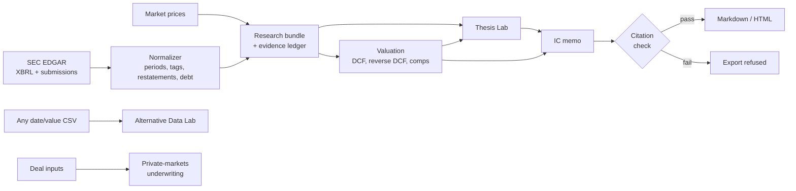

Investment OS is an institutional-style equity research and private-markets underwriting platform built to make investment hypotheses testable, auditable, and falsifiable.

- **Fundamental Research**
- **Reverse DCF**
- **Alternative-Data Testing**
- **LBO / Credit Underwriting**

It takes a US-listed company from SEC data to a source-linked investment committee memo, and shows what the current price requires you to believe. Not investment advice.

| | |
|---|---|
| **Input** | A ticker and an investment hypothesis |
| **Output** | Normalized financials, valuation, reverse DCF, tested thesis, IC memo with an evidence ledger |
| **Data** | SEC EDGAR (live), market prices (live), any date/value CSV |
| **Discipline** | Every number is labeled `reported`, `derived`, `assumed`, or `judgment`; a memo with an uncited claim will not export |
| **Verification** | 105 automated tests across normalization, valuation, signal research, underwriting, citations and the dashboard |


*Synthetic demo company. Figures are simulated and do not represent any security.*

## Why it exists

Most retail tools produce a number. An investment committee asks harder questions: where did that figure come from, what is already priced in, what would prove the thesis wrong, and did the signal survive out of sample?

Investment OS makes that chain explicit:

**hypothesis → evidence → model → valuation → counter-thesis → falsification conditions → decision**

When the data can't support an output, the system says so. Debt it can't reliably reconstruct stays blank, a bank gets no FCFF DCF, and a dataset that appears to contain future information is rejected.

## Key capabilities

| Area | What it does |
|---|---|
| **Company research** | Ticker → CIK → SEC data → annual and quarterly history → market cap and EV, with filing links |
| **Valuation** | Operating bridge from assumptions to FCFF to equity value, bull/base/bear, sensitivity, real-peer comps |
| **Reverse DCF** | Market-implied FCFF growth, revenue growth and EBIT margin |
| **Thesis testing** | Hypothesis → 3–7 testable claims with supporting and contradictory evidence and falsification tests |
| **Alternative data** | Tests whether a dataset adds information beyond a baseline and survives out of sample |
| **Private markets** | LBO returns, IRR/MOIC, DSCR, debt capacity, reverse purchase price |
| **IC memo** | Markdown and HTML export; citations link to the ledger, and the ledger links to SEC filings |

## Architecture



| Module | Responsibility |
|---|---|
| `investment_os/data/sec.py`, `normalize.py` | EDGAR client, filing links, XBRL normalization, debt reconstruction |
| `investment_os/pipeline.py` | Ticker → saved research bundle |
| `investment_os/core/evidence.py` | Evidence schema and ledger enforcement |
| `investment_os/models/valuation.py`, `workspace.py` | DCF engine, operating bridge, scenarios, implied expectations, comps |
| `investment_os/research/thesis_lab.py`, `ic_memo.py` | Claim testing, memo, citation validation, HTML export |
| `investment_os/research/agent.py` | Optional Claude layer, constrained by guardrails |
| `investment_os/signals/altdata.py` | Alternative-data testing protocol |
| `investment_os/private/lbo.py` | LBO, price and debt solvers |
| `investment_os/sectors/` | Diligence plug-ins for energy, semiconductors and consumer |
| `dashboard/app.py` | Six-page Streamlit workspace |

## Live data sources

| Source | Used for | Access | Notes |
|---|---|---|---|
| SEC Company Facts (XBRL) | Financial history, share counts | No key | Set an identifying `SEC_USER_AGENT` |
| SEC Submissions | Filing metadata and document links | No key | Limited to about 10 requests per second |
| Yahoo Finance via `yfinance` | Prices, when you run the tools locally | No key | Unlicensed convenience source; nothing derived from it is published in this repo |
| FRED | Macro series adapter | Optional key | Not used by the main workflow |
| Anthropic API | Optional claim rewording and critique | Optional key | The core workflow runs without it |

## Valuation workflow

1. **Anchor** growth, margin, tax and reinvestment from reported history. Each anchor is recorded as `assumed`, with its rule.
2. **Bridge** revenue → EBIT → taxes → NOPAT → D&A → capex → working capital → FCFF.
3. **Value** bull, base and bear cases, then walk EV to equity through debt, NCI, preferred and cash.
4. **Invert** the model: solve for the revenue CAGR, EBIT margin and FCFF CAGR that reconcile to market EV. The operating solves still work when current free cash flow is negative.
5. **Cross-check** against peer multiples computed from the same pipeline.

Enterprise value is computed only when debt and cash are reliable. Banks and other financial companies are refused, because FCFF is not meaningful for them.


*Normalized history for Vistra, from SEC filings data only.*

## Thesis-testing workflow

A hypothesis is mapped to claims on growth, margins, cash conversion, reinvestment, balance sheet and valuation. Each claim is then tested against filings data and reports:

- evidence required, supporting evidence and **contradictory evidence**
- status: supported, mixed, contradicted, or inconclusive
- a measurable falsification condition

The workflow is deterministic. Claims that filings can't test stay inconclusive. The optional LLM layer can reword claims, but a rewording that adds a number or an unknown citation is rejected.


*Synthetic demo company.*

## Alternative-data testing framework

The lab answers one question: **does this dataset contain incremental information, and does that survive out of sample?**

- **Timing:** a value is usable only after its date plus a declared publication lag. Each row pairs information known at *t* with the return over the following period.
- **Discipline:** lag, direction and scaling are fit on the training segment. Validation checks the choice, the test segment is scored once, and embargo gaps separate the segments.
- **Evidence:** incremental R² over a baseline, circular-shift permutation test, Bonferroni-adjusted lag search, reverse-causality check, transaction costs, drawdown, and parameter-stability diagnostics.
- **Known-answer checks:** the repo includes clearly labeled synthetic datasets.

| Synthetic dataset | Verdict at zero publication lag |
|---|---|
| Planted signal | Survives out of sample |
| Pure noise | No reliable incremental information |
| Contains next period's return | Leakage suspected |


*Synthetic dataset.*

## Private-markets underwriting

- Sponsor returns: IRR, MOIC, distributions, exit equity
- Lender view: CFADS, debt service and DSCR by year
- **Reverse underwriting:** the maximum purchase price at a target IRR
- **Debt sizing:** the maximum debt that holds a minimum DSCR
- Debt-service shortfalls capitalize onto the balance and are reported, not hidden

Default inputs on this page are illustrative.


*Illustrative inputs.*

## Evidence and citation controls

| Control | Rule |
|---|---|
| **Reported** evidence | Requires a source URL and a retrieval timestamp |
| **Derived** evidence | Requires a source, or inputs that already exist in the ledger |
| **Assumed / judgment** | May be unsourced, but is always labeled |
| **Memo export** | Refused unless each claim cites the ledger or is labeled `[Judgment]` |
| **LLM output** | Rejected if it cites evidence outside the ledger |
| **Missing data** | Left blank with a warning; never estimated silently |


*Synthetic demo company.*

## Setup

Tested on Python 3.12. The package declares support for 3.11+.

**macOS / Linux**

```bash
python -m venv .venv
source .venv/bin/activate
pip install -e ".[dev]"
cp .env.example .env
pytest -q
```

**Windows PowerShell**

```powershell
python -m venv .venv
.venv\Scripts\Activate.ps1
pip install -e ".[dev]"
Copy-Item .env.example .env
pytest -q
```

On Windows, clone to a shallow path such as `C:\src\investment-os`. Very deep paths can exceed Windows path limits and break dependency installation.

Edit `.env` and set `SEC_USER_AGENT` to your own name and email, as SEC fair-access rules ask. No API key is required.

## Demo workflow

### 1. Generate research on VST and NVDA

```bash
python scripts/research_company.py VST --peers CEG,NRG,TLN
python scripts/research_company.py NVDA --peers AMD,AVGO
```

Each run writes a bundle and memo to `outputs/<TICKER>/`, including `memo.md` and `memo.html`.

### 2. Open the workspace

```bash
streamlit run dashboard/app.py
```

### 3. Read the results

Live market values change, so they aren't published here. Run the commands above to see each company's market cap, enterprise value, reverse DCF and rating.

**SEC-reported starting point** (USD millions, latest fiscal year available from SEC data on November 8, 2026):

| | VST (FY2025) | NVDA (FY2026) |
|---|---|---|
| Revenue | 17,738 | 215,938 |
| Operating income | 1,906 | 130,387 |
| Net income | 944 | 120,067 |
| Operating cash flow | 4,070 | 102,718 |
| Capex | 2,752 | 6,042 |
| Free cash flow (derived) | 1,318 | 96,676 |
| Reconstructed debt | 18,843 | 8,468 |

**Output format, shown for a synthetic demo company.** Prices, peers and financials below are simulated.

| Output | Synthetic Demo Co |
|---|---|
| Share price | $165.00 |
| Enterprise value | $45.5B |
| Market-implied revenue CAGR | 10.2% |
| Market-implied EBIT margin | 19.0% |
| Market-implied FCFF CAGR | 8.8% |
| Weighted DCF per share (placeholder 9% WACC, 2.5% terminal growth) | $177.33 |
| Peer-implied per share (EV/EBITDA) | $151.00 |
| Rule-based rating | WATCH |

**Suggested walkthrough**

1. **Company Research → Audit trail:** trace a number to its XBRL tag and SEC filing.
2. **Reverse DCF:** see what each price requires, then change WACC or edit a scenario.
3. **Thesis Lab:** compare historical growth with what the market implies, and read the contradictory evidence.
4. **Alternative Data Lab:** run `SYNTHETIC: contains the future` and watch it get flagged.
5. **Private Markets:** solve for the maximum price at a target IRR.
6. **IC Memo:** check citations and export.

### Other commands

| Command | Purpose |
|---|---|
| `python scripts/research_company.py JPM` | See the system decline to run a DCF on a bank |
| `python scripts/research_company.py VST --offline` | Rerun analysis from a saved bundle |
| `python scripts/research_company.py VST --offline --thesis "Your hypothesis"` | Test your own thesis on a saved bundle, keeping its peers |
| `python scripts/build_sample_data.py` | Download local price series that add real ETF examples to the lab |
| `python scripts/demo.py` | Run the mechanics on illustrative inputs |
| `python scripts/live_company_snapshot.py VST` | Print the latest standardized SEC facts |

## Methodology & Limitations

- **Signal research enforces point-in-time alignment and leakage controls.** Signal values are used only after their declared publication date, and parameters are fit on training data only. Data revisions to user-supplied series are not modeled.
- **Company fundamentals currently use latest restated XBRL values and are not filing-vintage-aware for historical backtests.** A backtest on these fundamentals would not reflect what was known at the time.
- **DCF outputs depend on user assumptions.** Default WACC and terminal growth are placeholders. Terminal cash flow keeps current capex intensity, which can undervalue companies in heavy investment phases.
- **Evidence IDs do not prove semantic support.** They show only that claims are linked or labeled according to the evidence-ledger rule. A person must still judge whether the evidence supports the claim.

Also note:

- Ratings are mechanical screens, not recommendations.
- There are no consensus estimates, so variant views are measured against reverse-DCF expectations.
- Only standardized XBRL is parsed, not segment data, footnotes or filing text. Sector plug-ins add diligence questions, not numbers.
- Share counts are basic, without dilution. Operating leases are excluded from debt, and NCI and preferred are at book value.
- Financial companies get no valuation model.
- The earnings event study uses filing date as a proxy for the earnings date.
- Yahoo-sourced prices are unlicensed and should be replaced for production use.

More detail is in [BUILD_REPORT.md](BUILD_REPORT.md).

## Repository data policy

This repository publishes SEC-derived figures, synthetic data and illustrative inputs only. Market-price data and anything derived from it stay on your machine: generated bundles in `outputs/` and downloaded price series are excluded by `.gitignore`. Live market data still works when you run the tools locally.

## Development note

Development note: This project was designed and maintained by Anshpreet Singh with AI-assisted coding tools used during implementation and testing.

## License

Released under the [MIT License](LICENSE).
