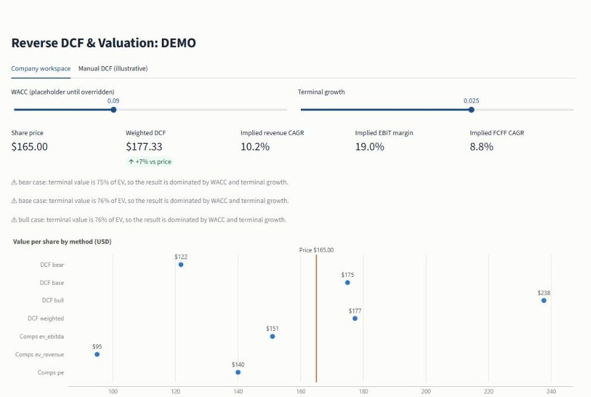
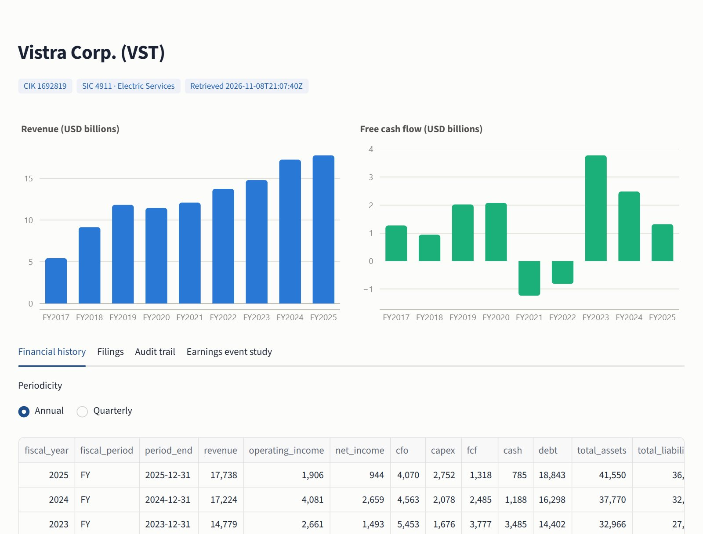
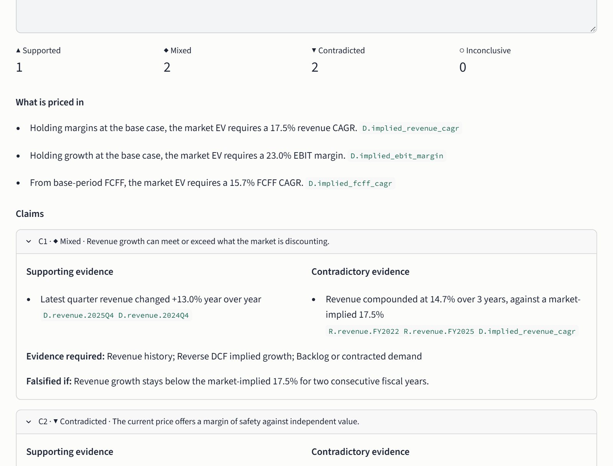
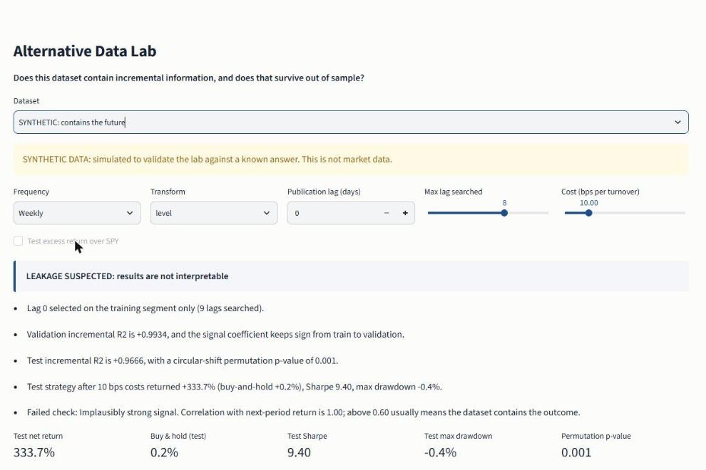
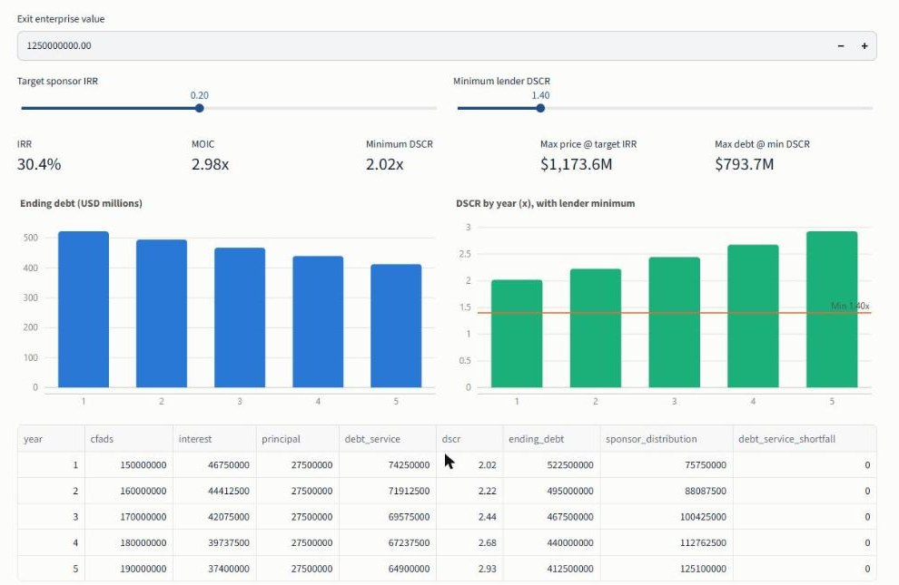
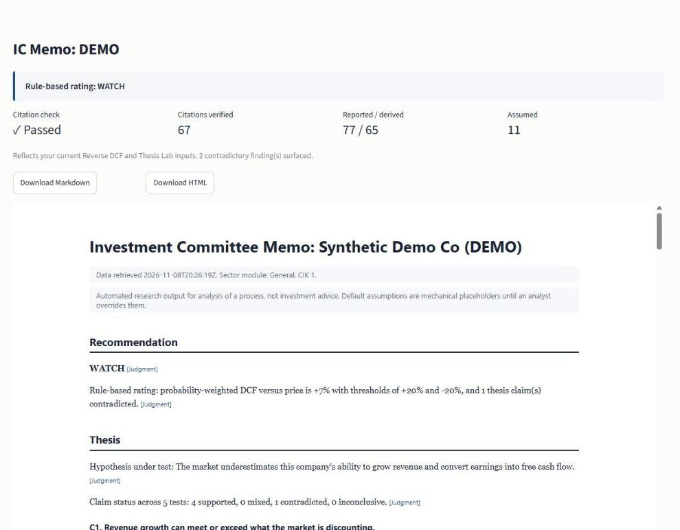

# Investment OS

[](https://github.com/ansh392/investment-os/actions/workflows/ci.yml)
[](pyproject.toml)
[](tests)
[](LICENSE)

Institutional-style equity research and private-markets underwriting platform built to make investment hypotheses testable, auditable, and falsifiable.

**Fundamental Research · Reverse DCF · Thesis Testing · Alternative-Data Testing · LBO / Credit Underwriting · Evidence-Linked IC Memos**



*Synthetic company. All figures are simulated. Not investment advice.*

## What it does

| Area | Output |
|---|---|
| **Fundamental research** | Ticker to normalized annual and quarterly history from SEC XBRL, with every number traced to its tag and filing |
| **Valuation and reverse DCF** | Operating bridge to FCFF and equity value, bull/base/bear, sensitivity, peer multiples, and the revenue growth, EBIT margin and FCFF growth the market price requires |
| **Thesis testing** | A hypothesis becomes 3–7 claims, each with supporting evidence, contradictory evidence and a measurable falsification condition |
| **Alternative-data testing** | Does a dataset add information beyond a baseline, and does that survive out of sample after leakage checks and costs? |
| **LBO / credit underwriting** | IRR, MOIC, DSCR, maximum purchase price at a target IRR, maximum debt at a minimum DSCR |
| **Evidence-linked IC memos** | Markdown and HTML memos that refuse to export if a claim is uncited. [Read a sample](examples/sample_ic_memo.md) |

## Why this is different

The system is designed around the questions an investment committee asks, not around producing a number.

- **Explicit assumptions.** Every forecast anchor is recorded with the rule that produced it. Placeholders are labeled as placeholders.
- **Contradictory evidence.** Each claim reports what argues against it, in the same view as what supports it.
- **Falsification conditions.** Each tested claim states what would prove it wrong.
- **No silent gap-filling.** Unreliable debt stays blank, a bank gets no FCFF DCF, and missing data produces a warning instead of an estimate.
- **Separated evidence types.** Every figure is `reported`, `derived`, `assumed` or `judgment`.
- **Out-of-sample signal validation.** Parameters are fit on training data, with embargoed validation and test segments and explicit leakage checks.
- **Auditable source lineage.** Memo citations resolve to a ledger, and reported ledger items link to their source filings.

These are design goals with stated limits. Read [what the system cannot do](docs/LIMITATIONS.md).

## 60-second demo

After the [Quick Start](#quick-start):

```bash
python scripts/research_company.py VST --peers CEG,NRG,TLN
streamlit run dashboard/app.py
```

Then, in the dashboard:

1. **Company Research → Audit trail:** trace a reported number to its SEC filing.
2. **Reverse DCF:** see what the current price requires you to believe.
3. **Thesis Lab:** read the supporting and contradictory evidence for each claim.
4. **Alternative Data Lab:** choose `SYNTHETIC: contains the future` and watch it get flagged as leakage.
5. **Private Markets:** read the maximum price at the target IRR, then change the inputs.
6. **IC Memo:** confirm the citation check passed and export the memo.

No network? `python scripts/build_example_memo.py --save-bundle outputs` adds a synthetic company instead. The [full walkthrough](docs/DEMO.md) covers NVDA and what to expect at each step.

## Quick Start

Requires Python 3.12, the only version tested. No API key is needed.

**macOS / Linux**

```bash
git clone https://github.com/ansh392/investment-os.git
cd investment-os
python -m venv .venv
source .venv/bin/activate
pip install -e ".[dev]"
cp .env.example .env
pytest -q
```

**Windows PowerShell**

```powershell
git clone https://github.com/ansh392/investment-os.git
cd investment-os
python -m venv .venv
.venv\Scripts\Activate.ps1
pip install -e ".[dev]"
Copy-Item .env.example .env
pytest -q
```

On Windows, clone to a shallow path such as `C:\src\investment-os`. Very deep paths can exceed Windows path limits and break dependency installation.

Edit `.env` and set `SEC_USER_AGENT` to your own name and email, as SEC fair-access rules ask.

## Screenshots

<table>
  <tr>
    <td width="50%"><a href="docs/screenshots/company-research.jpg"></a><br><sub><b>Company research.</b> SEC-derived figures only.</sub></td>
    <td width="50%"><a href="docs/screenshots/thesis-lab.jpg"></a><br><sub><b>Thesis Lab.</b> Synthetic company.</sub></td>
  </tr>
  <tr>
    <td width="50%"><a href="docs/screenshots/alternative-data-lab.jpg"></a><br><sub><b>Alternative Data Lab.</b> Synthetic dataset.</sub></td>
    <td width="50%"><a href="docs/screenshots/private-markets.jpg"></a><br><sub><b>Private markets.</b> Illustrative inputs.</sub></td>
  </tr>
  <tr>
    <td width="50%"><a href="docs/screenshots/ic-memo.jpg"></a><br><sub><b>IC memo.</b> Synthetic company.</sub></td>
    <td width="50%"><a href="docs/screenshots/reverse-dcf.jpg"></a><br><sub><b>Reverse DCF.</b> Synthetic company.</sub></td>
  </tr>
</table>

## Documentation

| Document | Contents |
|---|---|
| [Methodology](docs/METHODOLOGY.md) | DCF, comps, thesis testing, alternative-data protocol, leakage controls, LBO, evidence ledger |
| [Architecture](docs/ARCHITECTURE.md) | System design, data flow, modules |
| [Demo guide](docs/DEMO.md) | Exact commands, what to click, expected outputs |
| [Limitations](docs/LIMITATIONS.md) | What the system does not do |
| [Sample IC memo](examples/sample_ic_memo.md) | Full memo for a synthetic company |
| [Build report](BUILD_REPORT.md) | v1.0 scope, defects fixed, verification status |

## Repository data policy

This repository publishes SEC-derived figures, synthetic data and illustrative inputs only. Market-price data and anything derived from it stay on your machine: generated bundles in `outputs/` and downloaded price series are excluded by `.gitignore`.

## Development note

This project was designed and maintained by Anshpreet Singh with AI-assisted coding tools used during implementation and testing.

## License

Released under the [MIT License](LICENSE).
