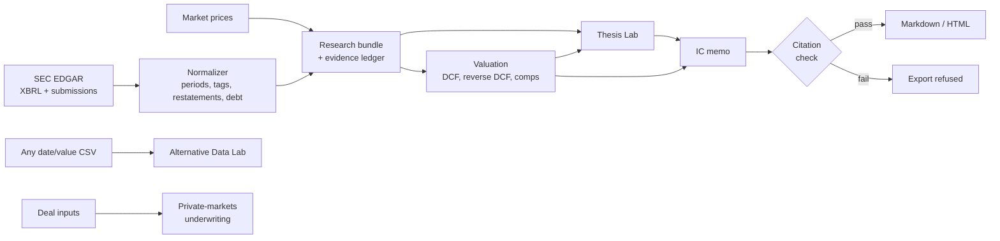

# Architecture

Investment OS is a single Python package with a Streamlit front end. A live company run produces a saved **research bundle**, and everything downstream reads from that bundle, so analysis can be rerun offline.

## System overview

The Alternative Data Lab and private-markets underwriting are standalone. They take their own inputs and do not feed the memo.

## Data flow for a company run

1. `SECClient` resolves ticker to CIK and fetches Company Facts and submissions, throttled for SEC fair-access limits.
2. `normalize_company_facts` builds annual and quarterly tables and a lineage table that records the tag, filing and method behind each value.
3. `build_ledger` turns recent lineage into evidence items, each linked to its filing.
4. `build_market_snapshot` computes market cap and EV only from inputs that are available, and records the reason for anything omitted.
5. `save_bundle` writes everything to `outputs/<TICKER>/`, which `.gitignore` excludes.
6. `run_valuation` extends a copy of the ledger with assumptions and model outputs.
7. `run_thesis_lab` tests claims against the normalized data and the valuation.
8. `build_memo` writes the memo, and `validate_citations` checks it before export.

## Modules

| Module | Responsibility |
|---|---|
| `investment_os/data/sec.py` | EDGAR client, rate limiting, filing links |
| `investment_os/data/normalize.py` | XBRL normalization, debt reconstruction, integrity warnings |
| `investment_os/data/market.py` | Price download via `yfinance` |
| `investment_os/data/fred.py` | Optional FRED adapter, not used by the main workflow |
| `investment_os/pipeline.py` | Ticker to saved research bundle, and bundle reload |
| `investment_os/core/evidence.py` | Evidence schema and ledger enforcement |
| `investment_os/models/valuation.py` | DCF, reverse DCF and sensitivity primitives |
| `investment_os/models/workspace.py` | Operating bridge, scenarios, implied expectations, comps |
| `investment_os/research/workflow.py` | Connects a bundle to valuation and records outputs as evidence |
| `investment_os/research/thesis_lab.py` | Claim selection and deterministic testing |
| `investment_os/research/ic_memo.py` | Memo, citation validation, HTML export, mechanical rating |
| `investment_os/research/agent.py` | Optional Claude layer, constrained by guardrails |
| `investment_os/research/memo.py`, `thesis.py` | Hand-assembled primitives used by `scripts/demo.py` |
| `investment_os/signals/altdata.py` | Alternative-data testing protocol |
| `investment_os/signals/analytics.py` | Basic signal helpers used by `scripts/demo.py` |
| `investment_os/private/lbo.py` | LBO, price and debt solvers |
| `investment_os/sectors/` | Diligence plug-ins for energy, semiconductors and consumer; they add questions, never numbers |
| `dashboard/app.py` | Six-page Streamlit workspace |
| `scripts/` | Command-line entry points |
| `tests/` | 105 automated tests, using hand-built fixtures with no network access |

## Design decisions

- **Evidence is enforced at insertion.** An item that fails the sourcing rules cannot enter the ledger, so downstream code doesn't need to re-check it.
- **All discounting goes through one function**, `dcf_valuation`, so forward and reverse DCF cannot drift apart.
- **The core workflow has no LLM dependency.** The Claude layer is optional, and a failure there leaves the deterministic output unchanged.
- **Failures explain themselves.** `ValuationNotApplicable` and the solver notes carry a reason to the user.
